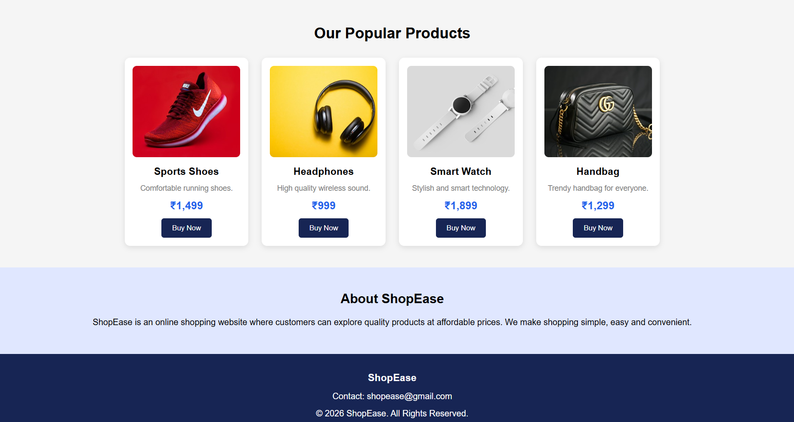

# Ex02 Commercial Website
## Date:02-11-2026

## AIM
To create a commercial website using CSS Flexbox.

## ALGORITHM
### STEP 1
Create an HTML file (index.html)

### STEP 2
Create a CSS file (style.css)

### STEP 3
Include a navigation bar with links to different sections.

### STEP 4
Add structured sections for Homepage, Products / Services, About Us, Contact Details and User Account.

### STEP 5
Include social media links at the footer with copyright information.

### STEP 6
Define global styles for fonts, colors, and layout.

### STEP 7
Style the header, navigation bar, and sections.

### STEP 8
Use Flexbox for layout design.

### STEP 9
Add hover effects and transitions for interactivity.

### STEP 10
Add Images and Media.

### STEP 11
Use optimized images for a professional look.

### STEP 12
Open the HTML file in a browser to check layout and functionality.

### STEP 13
Fix styling issues and refine content placement.

### STEP 14
Deploy the website.

### STEP 15
Upload to GitHub Pages for free hosting.

## PROGRAM

## index.html
```

<!DOCTYPE html>
<html>
<head>
    <title>ShopEase - Online Shopping</title>
    <link rel="stylesheet" href="style.css">
</head>
<body>

    <!-- Navigation Bar -->
    <header>
        <div class="logo">ShopEase</div>

        <nav>
            <a href="#">Home</a>
            <a href="#products">Products</a>
            <a href="#about">About</a>
            <a href="#contact">Contact</a>
        </nav>

        <button class="login">Login</button>
    </header>

    <!-- Hero Section -->
    <section class="hero">
        <div>
            <h1>Welcome to ShopEase!</h1>
            <p>Discover amazing products at the best prices.</p>
            <a href="#products" class="shop-btn">Shop Now</a>
        </div>
    </section>

    <!-- Categories -->
    <section class="categories">
        <h2>Shop By Category</h2>

        <div class="category-container">
            <div class="category">👕 Fashion</div>
            <div class="category">📱 Electronics</div>
            <div class="category">⌚ Accessories</div>
            <div class="category">🏠 Home Decor</div>
        </div>
    </section>

    <!-- Products -->
    <section class="products" id="products">
        <h2>Our Popular Products</h2>

        <div class="product-container">

            <div class="product-card">
                
                <h3>Sports Shoes</h3>
                <p>Comfortable running shoes.</p>
                <h4>₹1,499</h4>
                <button>Buy Now</button>
            </div>

            <div class="product-card">
                
                <h3>Headphones</h3>
                <p>High quality wireless sound.</p>
                <h4>₹999</h4>
                <button>Buy Now</button>
            </div>

            <div class="product-card">
                
                <h3>Smart Watch</h3>
                <p>Stylish and smart technology.</p>
                <h4>₹1,899</h4>
                <button>Buy Now</button>
            </div>

            <div class="product-card">
                
                <h3>Handbag</h3>
                <p>Trendy handbag for everyone.</p>
                <h4>₹1,299</h4>
                <button>Buy Now</button>
            </div>

        </div>
    </section>

    <!-- About -->
    <section class="about" id="about">
        <h2>About ShopEase</h2>
        <p>
            ShopEase is an online shopping website where customers
            can explore quality products at affordable prices.
            We make shopping simple, easy and convenient.
        </p>
    </section>

    <!-- Footer -->
    <footer id="contact">
        <h3>ShopEase</h3>
        <p>Contact: shopease@gmail.com</p>
        <p>© 2026 ShopEase. All Rights Reserved.</p>
    </footer>

</body>
</html>
```

## style.css
```

/* General Styling */
* {
    margin: 0;
    padding: 0;
    box-sizing: border-box;
    font-family: Arial, sans-serif;
}

body {
    background-color: #f5f5f5;
}

/* Navigation Bar */
header {
    background-color: #172554;
    color: white;
    padding: 20px 7%;
    display: flex;
    justify-content: space-between;
    align-items: center;
}

.logo {
    font-size: 28px;
    font-weight: bold;
    color: #facc15;
}

nav {
    display: flex;
    gap: 25px;
}

nav a {
    color: white;
    text-decoration: none;
    font-size: 16px;
}

nav a:hover {
    color: #facc15;
}

.login {
    padding: 10px 20px;
    background-color: #facc15;
    border: none;
    border-radius: 5px;
    cursor: pointer;
}

/* Hero Section */
.hero {
    height: 350px;
    background: linear-gradient(90deg, #172554, #2563eb);
    color: white;
    display: flex;
    justify-content: center;
    align-items: center;
    text-align: center;
}

.hero h1 {
    font-size: 42px;
    margin-bottom: 15px;
}

.hero p {
    font-size: 18px;
    margin-bottom: 25px;
}

.shop-btn {
    background-color: #facc15;
    color: black;
    padding: 12px 25px;
    text-decoration: none;
    border-radius: 5px;
    display: inline-block;
}

/* Categories */
.categories {
    padding: 40px 7%;
    text-align: center;
}

.categories h2,
.products h2 {
    margin-bottom: 30px;
    font-size: 28px;
}

.category-container {
    display: flex;
    justify-content: space-around;
    flex-wrap: wrap;
    gap: 15px;
}

.category {
    background-color: white;
    padding: 25px;
    border-radius: 10px;
    font-size: 18px;
    flex: 1;
    min-width: 150px;
}

/* Products */
.products {
    padding: 40px 7%;
    text-align: center;
}

.product-container {
    display: flex;
    justify-content: center;
    flex-wrap: wrap;
    gap: 25px;
}

.product-card {
    background-color: white;
    width: 230px;
    padding: 15px;
    border-radius: 10px;
    box-shadow: 0 3px 10px rgba(0,0,0,0.1);
    transition: transform 0.3s;
}

.product-card:hover {
    transform: translateY(-8px);
}

.product-card img {
    width: 100%;
    height: 170px;
    object-fit: cover;
    border-radius: 8px;
}

.product-card h3 {
    margin: 12px 0;
}

.product-card p {
    color: gray;
    font-size: 14px;
}

.product-card h4 {
    color: #2563eb;
    margin: 12px;
    font-size: 20px;
}

.product-card button {
    background-color: #172554;
    color: white;
    padding: 10px 20px;
    border: none;
    border-radius: 5px;
    cursor: pointer;
}

.product-card button:hover {
    background-color: #2563eb;
}

/* About Section */
.about {
    background-color: #e0e7ff;
    padding: 45px 10%;
    text-align: center;
}

.about h2 {
    margin-bottom: 15px;
}

.about p {
    line-height: 1.8;
}

/* Footer */
footer {
    background-color: #172554;
    color: white;
    text-align: center;
    padding: 25px;
    line-height: 2;
}

/* Responsive Design */
@media (max-width: 650px) {
    header {
        flex-direction: column;
        gap: 15px;
    }

    nav {
        flex-wrap: wrap;
        justify-content: center;
    }

    .hero h1 {
        font-size: 30px;
    }

    .product-card {
        width: 100%;
        max-width: 300px;
    }
}
```


## OUTPUT





## RESULT
The program for creating commercial website using CSS Flexbox is executed successfully.